# Valuation Journal: User Guide

Valuation Journal is a personal workspace for learning and documenting a discounted cash flow (DCF) valuation. It lays the valuation out as a pathway of phases, from setting the objective to the final conclusion. Inside each phase you keep a checklist, your notes and formulas, screenshots, key passages and the research files behind them. A revision mode helps you remember the important ideas, and you can keep separate journals for different companies or topics.

Everything runs in your web browser and is stored in the browser itself. There is no account, no server and no cloud.

**Contents**

1. Getting started
2. Finding your way around
3. The valuation pathway
4. Working inside a phase
5. Knowledge cards
6. The Library: snapshots and extracts
7. Documents
8. Searching
9. Recall: revising what you have learned
10. Journals
11. Backup and restore
12. Keyboard shortcuts
13. A suggested way of working
14. Questions and troubleshooting

---

## 1. Getting started

### Starting the app

Valuation Journal is a small web application that you run on your own computer. You need [Node.js](https://nodejs.org) installed once.

1. Open a terminal in the project folder.
2. The first time only, install its packages with `npm install`.
3. Start it with `npm run dev`.
4. Open **http://localhost:5173** in your browser.

Leave the terminal open while you use the app. Next time, only steps 3 and 4 are needed.

### Your first visit

The first time the app opens in a browser, it creates a starter journal called **DCF Valuation**. It has 13 phases, each with objectives, a checklist and a few starter knowledge cards. You can rename, change, reorder or delete all of it: the starter content is written only once and never overwrites your changes.

### Where your data lives

Your journals, images and documents are stored in the browser you use (in its built-in database, IndexedDB). That has three consequences worth knowing from day one:

- **Use the same browser.** Another browser, another computer or a private window starts with a fresh starter journal.
- **Clearing the browser's site data deletes your journals**, files included.
- **Export backups regularly** (see section 11) and keep the ZIP files somewhere safe. A backup is the only copy of your work outside the browser.

---

## 2. Finding your way around

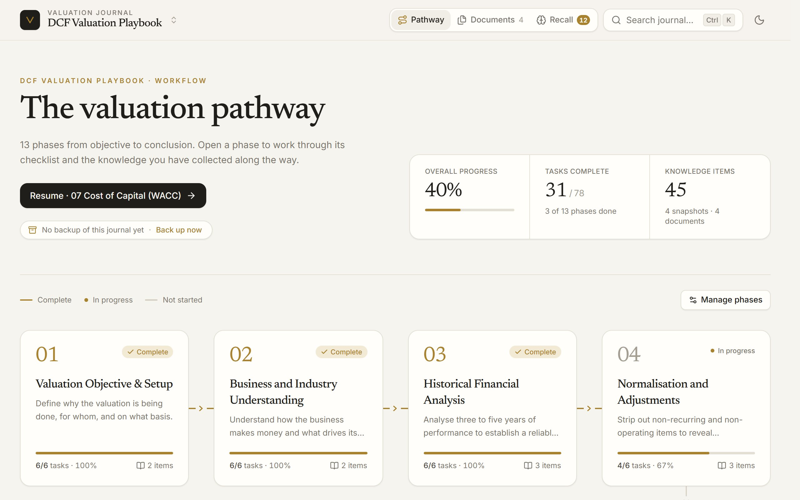
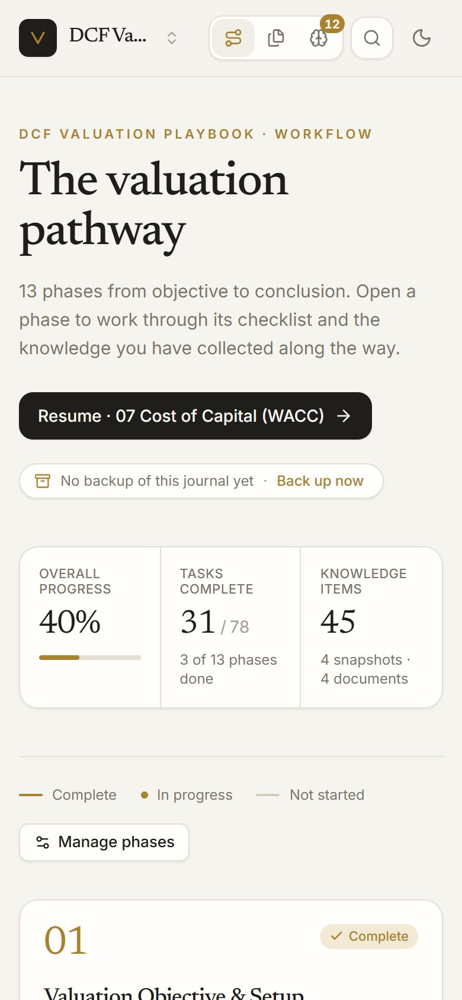

The bar at the top of every page has, from left to right:

| Element | What it does |
| --- | --- |
| **Journal name** (with the gold logo) | Shows the open journal. Click it to switch journals, create a new one, manage them, or back up and restore (section 10). |
| **Pathway** | The overview of all phases. |
| **Documents** | The Document Library: every research file in the journal (section 7). The number shows how many there are. |
| **Recall** | Revision with flashcards (section 9). A gold badge shows how many cards are due. |
| **Search** | Searches the whole journal, including the text inside PDFs. Shortcut: `Ctrl + K` (`Cmd + K` on a Mac) or `/`. |
| **Sun / moon** | Switches between the light and dark themes. |

The app works on a phone too: the navigation shrinks to icons and the layout stacks.

---

## 3. The valuation pathway

The overview (**Pathway**) shows your whole valuation at a glance.

- **Overall progress, tasks complete and knowledge items** summarise the journal.
- **Resume** reopens the phase you were last working in.
- **Backup reminder:** if the journal holds documents or snapshots and has never been backed up, or the last backup is more than 30 days old, a small notice appears with a **Back up now** link.
- **The phase cards** follow the order of the work. Each shows its number, title, short description, checklist progress and how many items it holds. A gold line means complete, a gold dot means in progress.

Click a phase card to open it. The card expands into the phase's workspace.

### Managing phases

**Manage phases** (above the pathway) lists every phase. There you can:

- **Add** a phase with a title, description and objectives.
- **Reorder** phases by dragging the handle or with the up and down arrows. Phase numbers follow the new order everywhere.
- **Edit** or **delete** a phase.

Deleting a phase permanently removes its checklist, knowledge cards, snapshots and extracts, and asks you first. Documents filed in it are **kept** in the Document Library as "Unfiled".

---

## 4. Working inside a phase

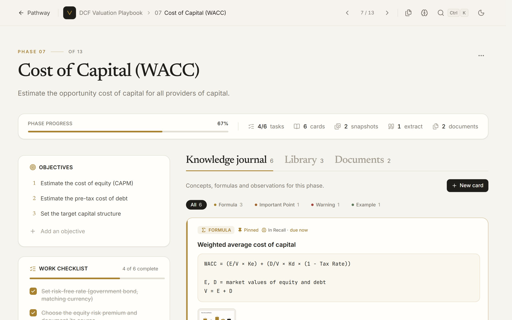

At the top of a phase:

- **Back** (top left) returns to the page you came from (the pathway, the Document Library or Recall). `Esc` does the same.
- **Previous / next** arrows (or the `←` and `→` keys) move to the neighbouring phase.
- The icons on the right open the **Document Library**, **Recall** and **Search**.
- The **title** and **description** are editable: click them, type, and press `Enter` to save.
- The **⋯ menu** edits the phase's details, moves it earlier or later, or deletes it.
- The **progress bar** and counts show tasks, cards, snapshots, extracts and documents in the phase.

### Objectives and checklist

- **Objectives** state what the phase must achieve. Click **Add an objective** to add one.
- The **work checklist** holds the tasks. Tick a task when it is done; click its text to edit it; **Add a task** adds one. Completed tasks drive the phase's progress and the overall progress on the pathway.

### The three tabs

The right-hand side has three tabs:

- **Knowledge journal:** your cards (section 5).
- **Library:** screenshots, figures and saved passages (section 6).
- **Documents:** the research files for this phase (section 7).

---

## 5. Knowledge cards

Knowledge cards hold what you learn: a concept, a formula, an assumption you made and why.

### Card types

| Type | Use it for |
| --- | --- |
| **Concept** | An idea or definition, e.g. "Standard of value". |
| **Formula** | An equation. It is shown in a fixed-width font so it lines up. |
| **Assumption** | An input you chose and why. |
| **Important Point** | Something you must not forget. |
| **Warning** | A common mistake or trap. |
| **Example** | A worked example or illustration. |
| **Decision** | A choice you made in this valuation and the reasoning. |
| **Source Extract** | A quotation, shown in the serif typeface. |

### Creating and editing cards

1. Click **New card**.
2. Choose a type, then add a title, the content, tags and, optionally, a source (report, page, URL).
3. Save with the button or `Ctrl + Enter`.

Hover over a card to see its tools:

- **Add to Recall** (brain icon): turns the card into a flashcard (section 9).
- **Attach an image** (picture icon): uploads an image linked to this card.
- **Connect documents** (paperclip): links the card to files in the Document Library.
- **Pin** keeps the card at the top of the list.
- **Edit** and **Delete**.

Use the chips above the list to show one card type at a time, and click a **#tag** on any card to filter by that tag.

---

## 6. The Library: snapshots and extracts

The **Library** tab collects visual evidence and important passages for the phase.

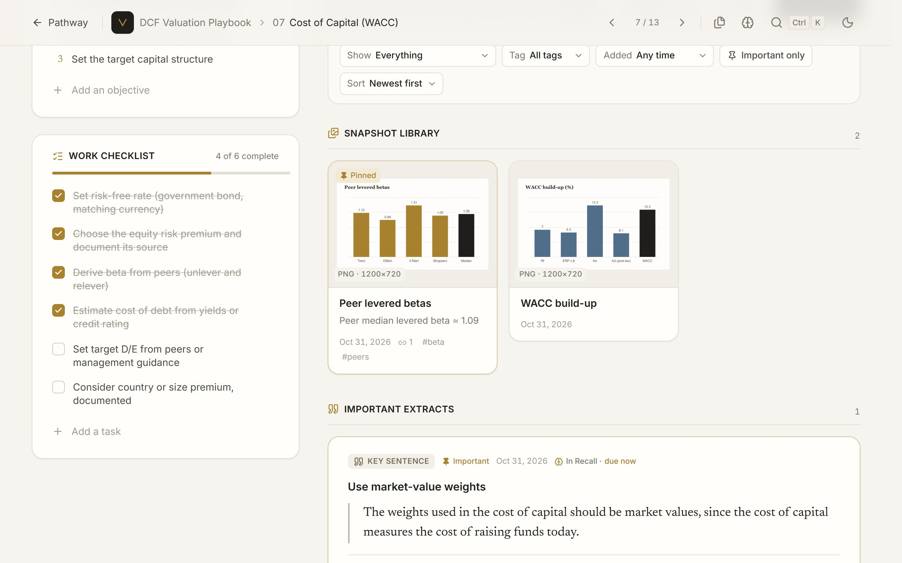

### Snapshots (screenshots and images)

You can add a snapshot in three ways:

- **Paste:** copy a screenshot (for example with `Win + Shift + S` on Windows), then press `Ctrl + V` anywhere inside the phase. It is saved straight away.
- **Drag and drop** image files anywhere onto the phase page.
- **Upload image** or **Paste** buttons in the Library tab.

PNG, JPG and WebP images up to 25 MB are supported. Each snapshot can have a title, caption, description, tags and links to knowledge cards (use **Edit** on the snapshot). Pinned snapshots come first.

Click a snapshot to open the **image viewer**:

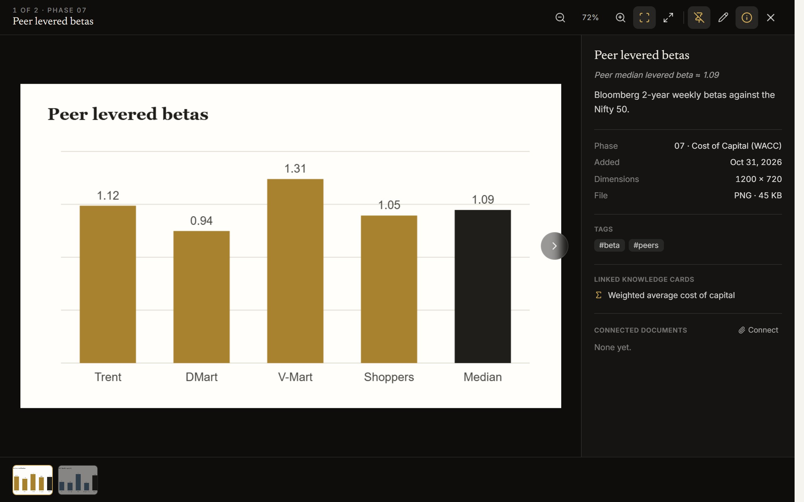

- Zoom with the `+` / `−` buttons or keys, the mouse wheel (zooms at the cursor) or a double-click; drag to move around.
- `0` fits the image to the screen, `1` shows it at actual size.
- `←` / `→` and the filmstrip move between images; `F` is full screen; `I` shows or hides the details panel.
- The details panel lists the linked knowledge cards and connected documents, and lets you connect more documents.

### Important extracts

Extracts are passages worth keeping: a key sentence from an annual report, a modelling observation, a formula, a lesson learned.

- **Quickest way:** copy text from anywhere, click on an empty part of the phase page (not inside a text box), and press `Ctrl + V`. A new extract opens with the text filled in and a suggested kind.
- Or click **New extract**.

Each extract has a **kind** (key sentence, paragraph, modelling observation, formula, explanation or lesson learned), an optional title, the **source document** and **page or section**, an optional web link, tags, and an **Important** marker. On an extract, the copy icon copies the text with its citation.

### Filtering the Library

Use the filters at the top to show **everything**, only snapshots, or one kind of extract; pick a **tag**; limit by date added (past 7, 30 or 90 days); show **important only**; and sort newest or oldest first.

---

## 7. Documents

Documents are your research files: annual reports, models, filings, broker notes, transcripts.

### Supported files

| Format | In the app |
| --- | --- |
| **PDF** | Full viewer: pages, zoom, fit width or page, find with highlights, selectable text, full screen |
| **Images** (PNG, JPG, WebP, GIF) | Preview with fit and zoom |
| **Text** (TXT) and **Markdown** | Text preview; Markdown can be shown formatted or as source |
| **CSV / TSV** | Table preview (the first 2,000 rows) |
| **Excel, Word, PowerPoint** | Stored safely with their details and a download button. There is no in-app preview for these: they can't be shown reliably without a cloud service |

Files can be up to 200 MB each.

### Adding documents

- In a phase, open the **Documents** tab and click **Upload documents**, or drag files onto the page. Files dropped on the Journal or Library tabs are added too: images become snapshots, other files become documents.
- In the **Document Library**, click **Upload documents** or drop files anywhere on the page. If a phase filter is selected, new files are filed under that phase; otherwise they are **Unfiled**.
- You can also paste a copied file with `Ctrl + V`.

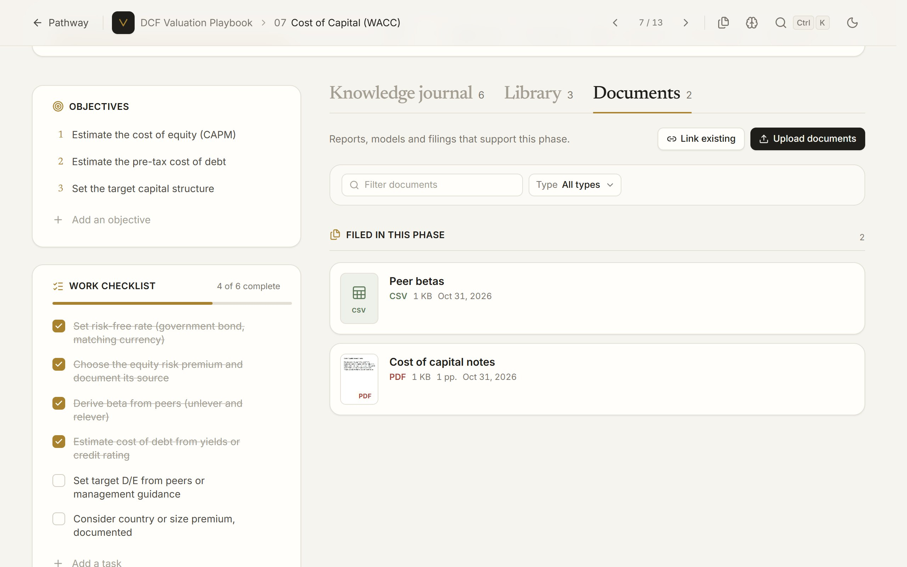

A phase's Documents tab shows files **filed in this phase** and files **linked from other phases**. **Link existing** connects a document that is filed elsewhere.

### The Document Library

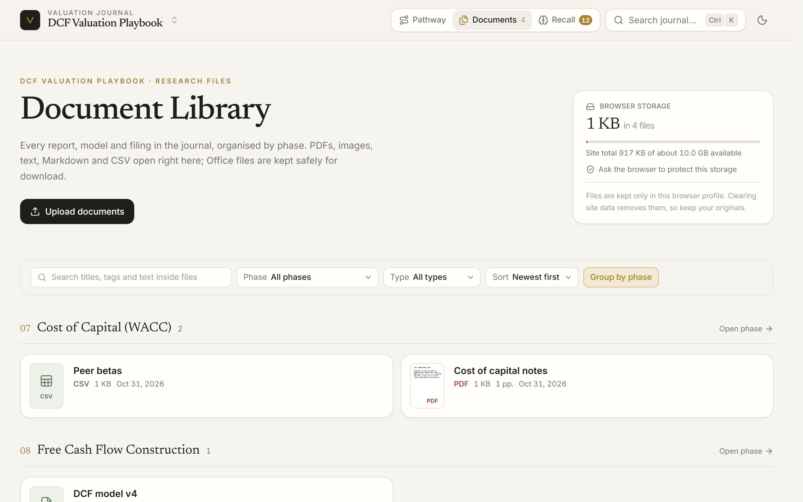

The Document Library lists every document in the journal.

- **Search** looks in titles, file names, descriptions, tags **and the text inside** PDFs, text, Markdown and CSV files. Results show an excerpt of the matching text.
- **Filter** by phase, type and tag; **sort** by date, title or size; switch **Group by phase** on or off.
- The **storage panel** shows how much space your files use and how much the browser allows. **Ask the browser to protect this storage** asks it not to clear the data when space runs low; once granted, the panel says "Protected from automatic clearing".

### Viewing a document

Click a document to open it.

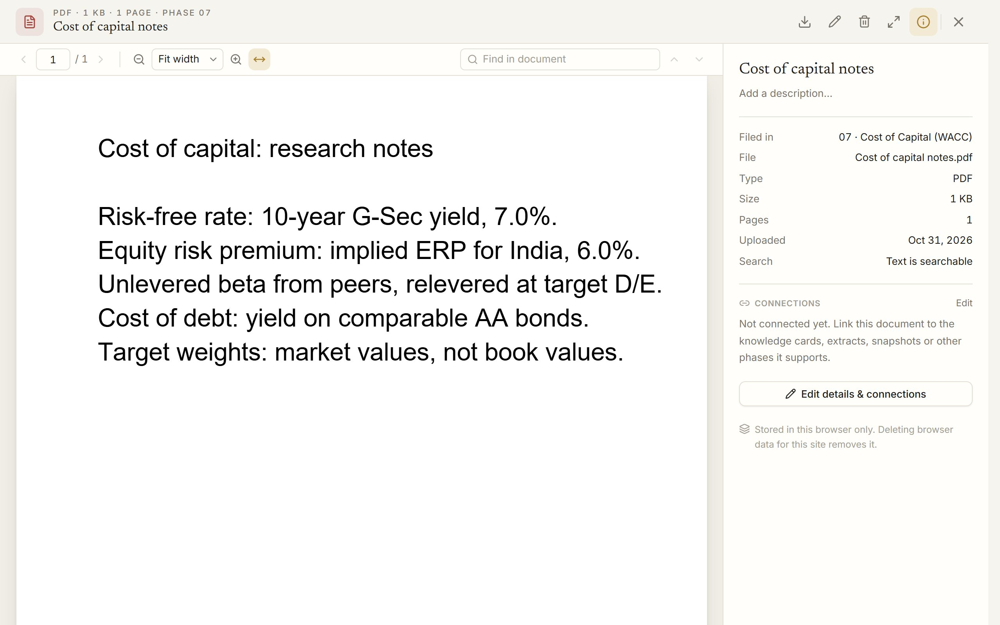

In the **PDF viewer**:

- Move between pages with the arrows, by typing a page number, or with `N` and `P`.
- Zoom with the buttons, the zoom menu, `+` / `−`, or `Ctrl + mouse wheel`. Choose **Fit width** or **Fit page**.
- **Find in document** (`Ctrl + F`) highlights every match; `Enter` and `Shift + Enter` move between them.
- Text can be selected and copied.
- `F` is full screen, `I` shows or hides the details panel, `Esc` closes the viewer.

The **details panel** shows the file's information and its **connections**. Click **Edit details & connections** to change the title, description and tags, file the document under a phase, relate it to other phases, and connect it to knowledge cards, extracts and snapshots. Click any connection to jump straight to it.

The download icon saves the original file under its original name. Deleting a document removes the file and its search text; anything it was connected to is kept.

---

## 8. Searching

Press `Ctrl + K` (or `/`) anywhere, or click the search box.

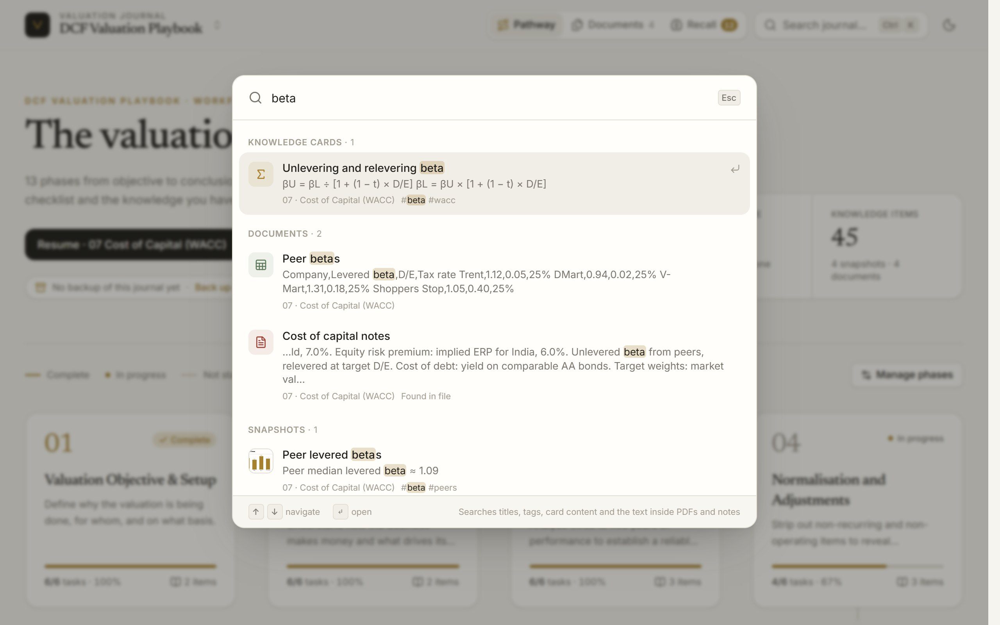

Search covers phases, checklist tasks, knowledge cards, snapshots, extracts and documents, including the text inside your files. Type several words to narrow it down, or `#tag` to search by tag. Use `↑` / `↓` and `Enter` to open a result: the app opens the right phase and tab and briefly highlights the item. A PDF result opens the document with your search already run inside it.

Search covers only the **open journal**.

---

## 9. Recall: revising what you have learned

Recall turns your knowledge cards and extracts into flashcards, so the important ideas stay with you without rereading long PDFs.

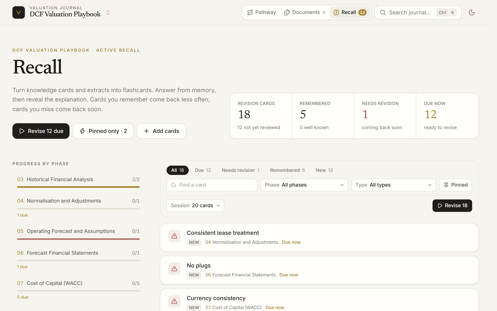

### Adding cards to Recall

- On any knowledge card or extract, hover and click the **brain icon**. The card now shows "In Recall" with its next review date.
- Or click **Add cards** on the Recall page to choose many at once. Filter by phase, type or pinned, search, and use **Select N shown** to tick everything visible.

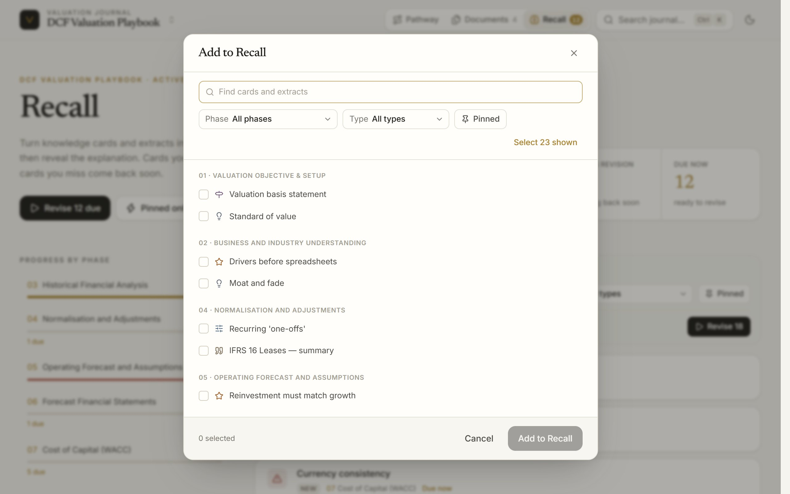

A flashcard is **linked** to its card, not copied: when you edit the card, the flashcard changes too. Deleting the card removes it from Recall. Removing a flashcard from Recall keeps the original card.

### The Recall page

- **Revision cards, Remembered, Needs revision and Due now** summarise your deck.
- **Progress by phase** shows how much of each phase you have remembered; click a phase to filter by it.
- **Filters:** All, Due, Needs revision, Remembered, New; phase; type; pinned; and text search.
- **Session** sets how many cards a session holds: 10, 20, 50 or all. This makes it easy to revise a few important concepts in a couple of minutes.
- **Revise N due** starts with the cards that are due. **Pinned only** revises just the pinned ones. **Revise N shown** revises whatever the filters show.
- On each card in the list: revise just that card, **edit the question**, open it in the journal, or remove it from Recall.

By default the front of a flashcard shows the card's title. Use **Edit question** (pencil icon) to write your own question instead, e.g. "Why are market-value weights used in WACC?".

### A revision session

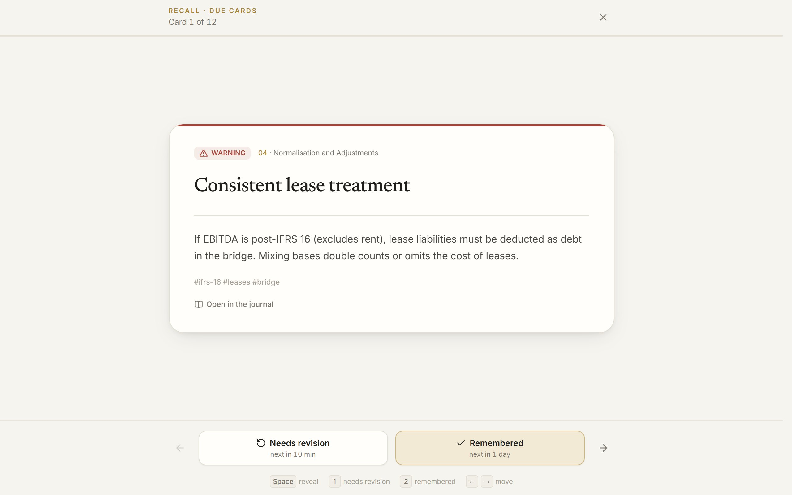

1. Read the question and try to answer it from memory.
2. Press `Space` (or click **Show the answer**).
3. Choose **Needs revision** (`1`) or **Remembered** (`2`). Each button shows when the card will come back.
4. The next card appears. `←` / `→` move between cards; going back to a card you have already rated lets you change your rating.
5. At the end you see a summary, with the option to go through the missed cards again. `Esc` ends a session at any time.

The source reference and tags appear under the answer, and **Open in the journal** jumps to the original card.

### How scheduling works

Recall uses a simple ladder:

- **Remembered** moves a card one step up, so it returns after **1, 3, 7, 14, 30, 60 and then 120 days**.
- **Needs revision** sends it back to the bottom; it returns after **10 minutes**.
- New cards are due straight away.

Cards remembered at the 14-day step or above count as "well known".

---

## 10. Journals

A journal is a complete, separate project: its own phases and their order, checklists, cards, snapshots, extracts, documents, tags and Recall deck. You might keep a "DCF Valuation Playbook" for the method, one journal per company you value (for example "Trent Limited Valuation"), and a "Cost of Capital Reference".

Nothing is shared between journals. Search, the Document Library and Recall always show only the open journal.

### Switching journals

Click the journal name at the top left.

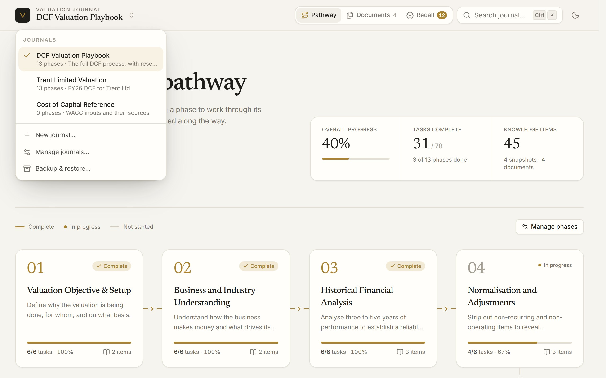

Pick a journal to open it; the app remembers your choice next time. The menu also has **New journal**, **Manage journals** and **Backup & restore**.

### Creating a journal

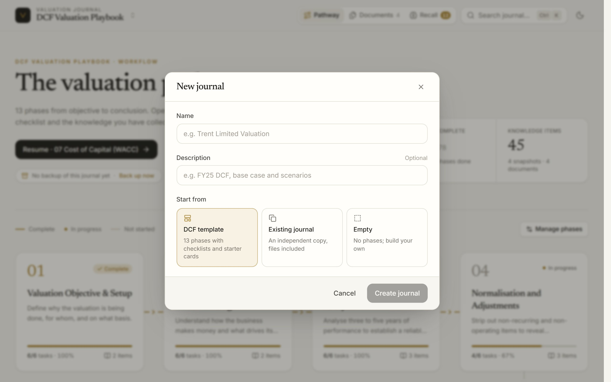

Give it a name and an optional description, then choose what it starts from:

- **DCF template:** the 13 standard phases with their checklists and starter cards.
- **Existing journal:** a complete, independent copy of another journal, files included. Changes to one never affect the other.
- **Empty:** no phases; build your own structure.

### Managing journals

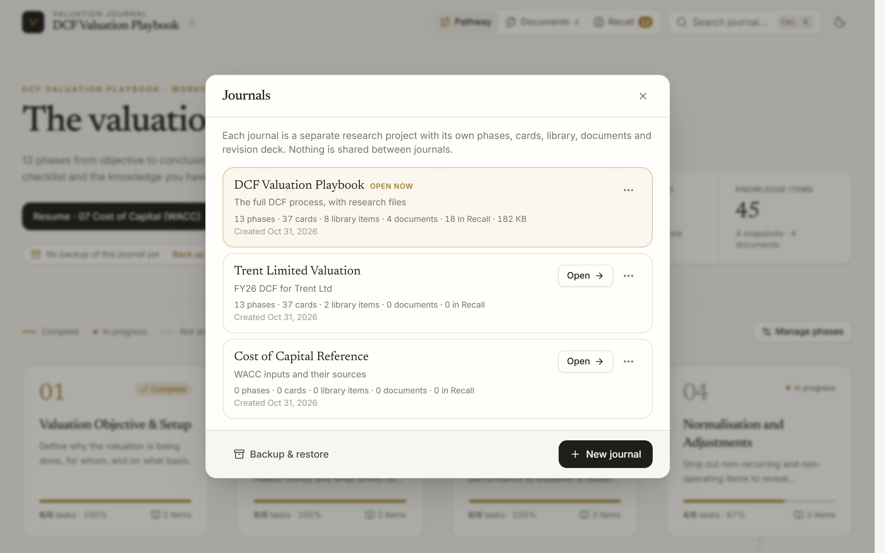

**Manage journals** shows what each journal holds and when it was created. From the **⋯ menu** on each journal you can **rename**, **duplicate**, **export a backup** of it, or **delete** it.

Deleting a journal permanently removes everything in it and asks you first, listing exactly what will go. Other journals are not affected. The last remaining journal can't be deleted.

---

## 11. Backup and restore

Open **Backup & restore** from the journal menu (or **Back up now** on the overview).

### Exporting a backup

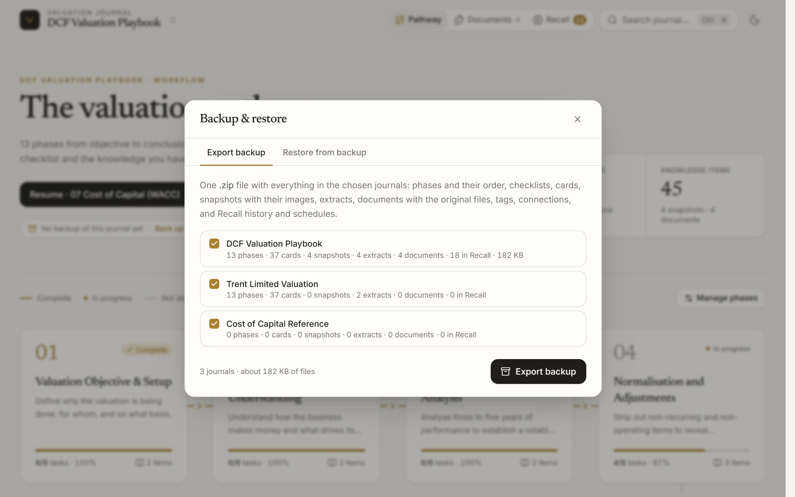

1. Tick the journals to include (all are ticked to start with).
2. Click **Export backup**.

The app saves one `.zip` file to your browser's **Downloads** folder, named like `DCF Valuation Playbook backup 2026-10-31.zip`. It contains everything in the chosen journals: phases and their order, checklists and their ticks, cards, snapshots with the original images, extracts, documents with the original files, tags, connections, and your Recall history and schedules.

Copy the file somewhere safe, such as an external drive or a cloud folder of your choice. Exporting resets the backup reminder for those journals.

### Restoring from a backup

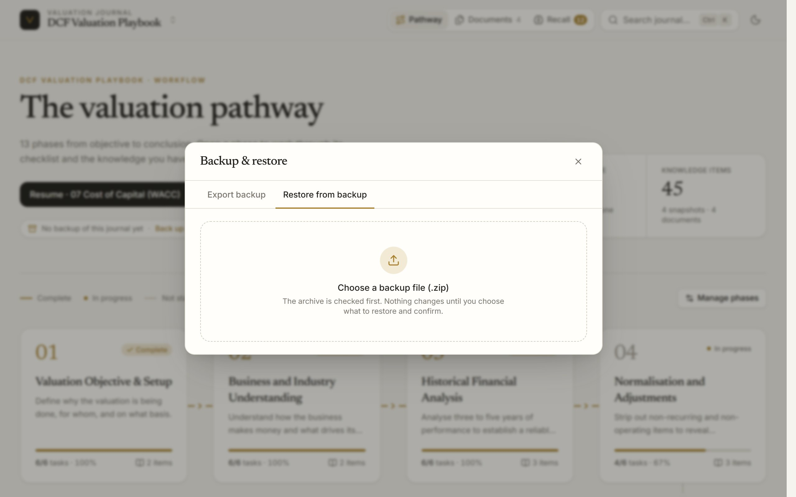

1. Open the **Restore from backup** tab and choose a `.zip` file.
2. The app checks the file first. Damaged files, files that aren't Valuation Journal backups, and backups from a newer version are refused with an explanation. Nothing has changed at this point.
3. For each journal in the backup, choose:
   - **Import as a new journal:** adds it alongside your existing journals. If a journal with that name exists, the new one is called "Name (2)".
   - **Replace "Name":** offered when a journal with the same name (or the same original journal) exists. Its current contents are deleted and replaced by the backup's. You are asked to confirm.
   - **Skip.**
4. Click **Restore**. When it finishes, the first restored journal opens.

A restore never mixes records with what is already there, and restoring does not count as a backup for the reminder.

**Limits:** one backup must stay under 4 GB. If your journals are very large, export them one at a time.

---

## 12. Keyboard shortcuts

**Anywhere**

| Keys | Action |
| --- | --- |
| `Ctrl + K` or `/` | Search the journal |
| `Esc` | Close the dialog or viewer, or go back from a phase |
| `Ctrl + Enter` | Save a card, snapshot, extract or document form |
| `Enter` | Save an inline edit (`Shift + Enter` for a new line) |

**In a phase**

| Keys | Action |
| --- | --- |
| `←` / `→` | Previous / next phase |
| `Ctrl + V` | Paste a screenshot (snapshot), text (extract) or file (document) |

**Image viewer**

| Keys | Action |
| --- | --- |
| `←` / `→` | Previous / next image |
| `+` / `−` | Zoom in / out |
| `0` / `1` | Fit to screen / actual size |
| `F` / `I` | Full screen / details panel |

**Document viewer**

| Keys | Action |
| --- | --- |
| `Ctrl + F` | Find in the PDF |
| `Enter` / `Shift + Enter` | Next / previous match |
| `N` / `P` | Next / previous page |
| `+` / `−`, `Ctrl + wheel` | Zoom |
| `F` / `I` | Full screen / details panel |

**Recall session**

| Keys | Action |
| --- | --- |
| `Space` or `Enter` | Show the answer |
| `1` | Needs revision |
| `2` | Remembered |
| `←` / `→` | Previous / next card |
| `Esc` | End the session |

On a Mac, use `Cmd` instead of `Ctrl`.

---

## 13. A suggested way of working

1. **Keep a playbook journal** for the method itself: the DCF template, with your own cards, formulas and lessons added over time.
2. **Start each company from the template** (or duplicate the playbook) so every valuation follows the same structure.
3. **As you read**, paste screenshots of key tables and charts, and paste important sentences as extracts with their page numbers. Upload the source reports to the phase they support.
4. **Connect** cards, extracts and snapshots to the documents they come from, so you can always get back to the source in one click.
5. **Tick the checklist** as you go; the pathway shows where you are.
6. **Add the ideas worth remembering to Recall**, write clear questions for them, and spend a few minutes on **Revise due** regularly.
7. **Export a backup** whenever you finish a significant piece of work, and at least monthly.

---

## 14. Questions and troubleshooting

**I opened the app and my journals are gone.**
You are probably in a different browser, a different browser profile or a private window, or the site data was cleared. Use the browser you normally use. If the data was cleared, restore your latest backup (section 11).

**The browser says storage is full, or a file won't save.**
Each file can be up to 200 MB, and the browser limits the total space. Delete large documents you no longer need, check the storage panel in the Document Library, and click **Ask the browser to protect this storage** so it doesn't clear data on its own.

**My Excel, Word or PowerPoint file doesn't preview.**
That is expected: these are stored safely and can be downloaded, but they can't be displayed inside the app without a cloud viewer.

**Search doesn't find text in my PDF.**
Scanned PDFs (pictures of pages) have no text layer, so they can be viewed but not searched. Text inside Excel, Word and PowerPoint files isn't searched either.

**The backup file was refused.**
The message says why: the file is damaged or incomplete, it isn't a Valuation Journal backup, or it was made by a newer version. Try another copy of the backup.

**I restored a backup and now have "Name (2)".**
You chose **Import as a new journal** while a journal with that name already existed. Delete the one you don't need from **Manage journals**, or next time choose **Replace**.

**Full screen doesn't work.**
Some browsers or embedded windows block full screen; the app shows a message when that happens. Try a normal browser window.

**I want less animation.**
Turn on your operating system's "reduce motion" setting; the app then uses simple fades instead of the zoom and slide effects.
